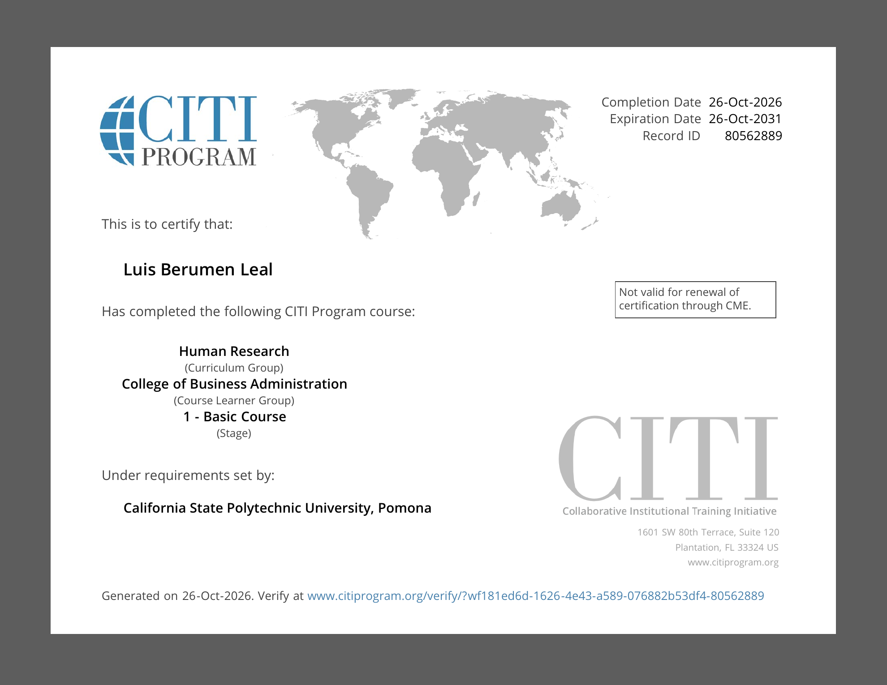
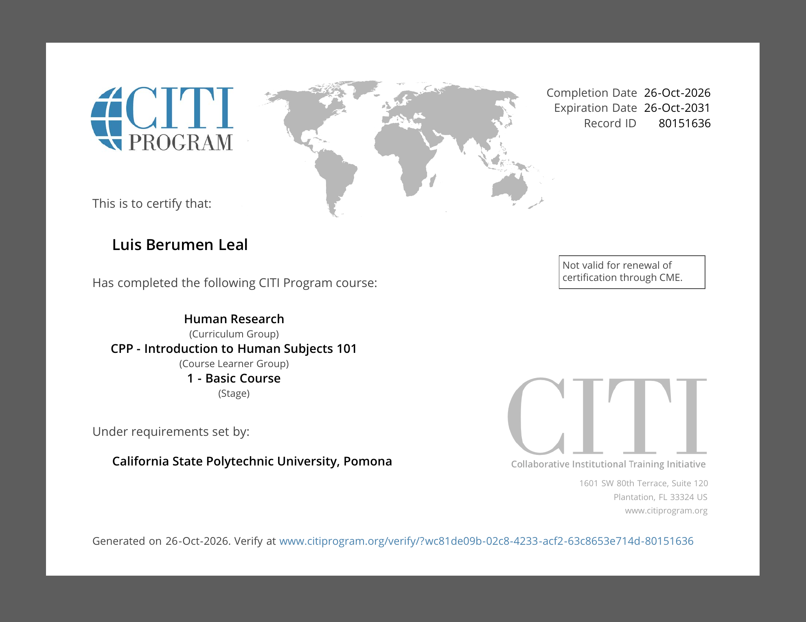

## College of Business Administration Certificate

{width="90%"}

## Introduction to Human Subjects 101 Certificate

{width="90%"}

## Appendix

- **GitHub Repository:** <https://github.com/Brahhmen55/IBM6500->
- **Published GitHub Pages Report:** <https://brahhmen55.github.io/IBM6500-/CITI-Certification/>
