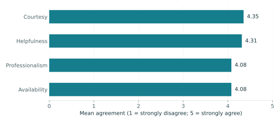
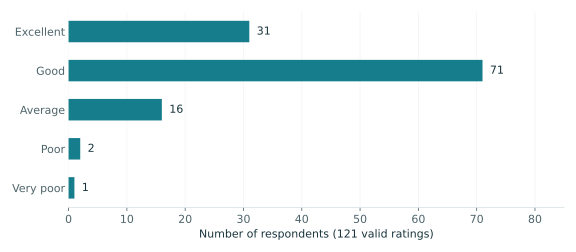
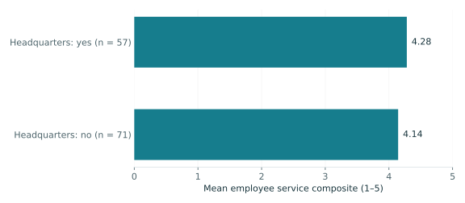

## Row

::: {.valuebox icon="people" color="primary"}
Survey respondents

128
:::

::: {.valuebox icon="person-check" color="info"}
Employee service / 5

4.21
:::

::: {.valuebox icon="hand-thumbs-up" color="success"}
Excellent or good

84.3%
:::

## Row

::: {.card title="Service strengths and improvement areas"}

Courtesy leads the four employee measures. Professionalism and availability are tied for the lowest average, although both exceed 4 out of 5. Each item has 128 valid responses.
:::

::: {.card title="Overall credit union experience"}

102 of 121 valid ratings are excellent or good (**84.3%**). Seven of the 128 records have missing overall ratings and are excluded from this percentage.
:::

## Row

::: {.card title="Employee service by headquarters response"}

The descriptive gap is **0.14 points** on a five-point scale. This comparison does not establish a statistically significant difference or a causal effect.
:::

::: {.card title="What should managers do next?"}
1. **Maintain courteous, helpful service.** These are the highest rated employee attributes.
2. **Investigate availability and professionalism.** Use follow-up interviews to identify specific friction before changing staffing or training.
3. **Listen to less satisfied members.** Nineteen valid respondents rated the credit union average or worse; understand their experiences before prioritizing fixes.

These are recommendations to investigate, not proven causes of satisfaction.
:::

## Row

::: {.card title="Data notes and reproducibility"}
**Source:** [Jae Jung’s Case 31 repository](https://github.com/jaejungca/case31), `Case 31 Data_efcu_Prepped.sav` (128 rows, 54 variables). Educational case data; no claim of current market representativeness.

**Definitions:** Employee service is `at_emp`, verified against the mean of `q3`–`q6` for all 128 records. These items use 1 = strongly disagree to 5 = strongly agree. Headquarters is `q38` (1 = yes; 2 = no). Overall rating uses original `q37` codes (1 = excellent; 5 = very poor); missing values are excluded.

**Method:** Unweighted descriptive statistics; available valid responses are used for each measure. This dashboard does not test significance or generalize beyond the supplied sample. The charts use a common 0–5 baseline for the 1–5 service scores.

[Return to portfolio](index.qmd) · [Get the original course dataset](https://github.com/jaejungca/case31/blob/main/Case%2031%20Data_efcu_Prepped.sav) · [Source files](https://github.com/Brahhmen55/IBM6500-/tree/main/M11)

Run `python scripts/rebuild.py` from the project folder to recalculate the metrics and regenerate charts. The website itself renders without R or Python execution because the verified chart outputs are included.
:::
